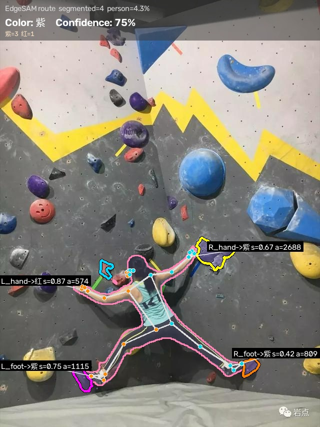
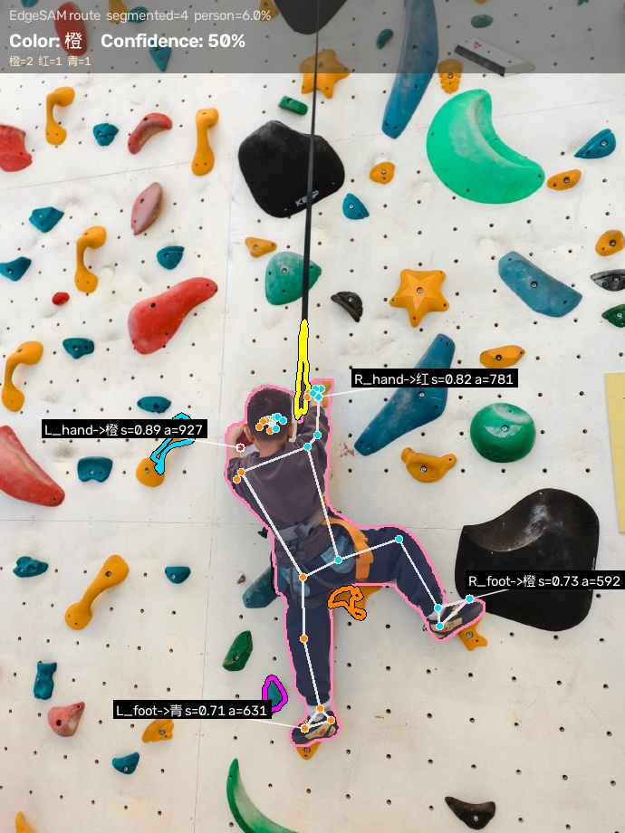
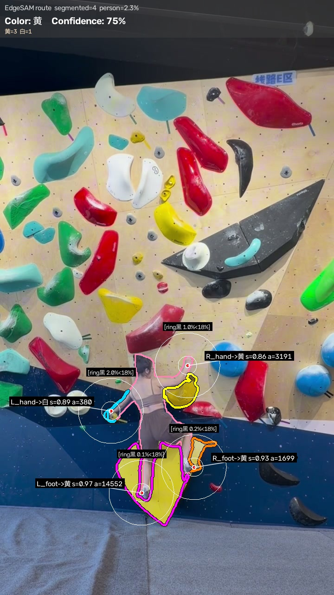

# ClimbColor

> 从攀岩视频帧自动识别攀爬者正在攀爬的**线路颜色**（紫 / 黄 / 绿 / 蓝 / 红 / 粉 / 白 / 黑 / 青）。
> 姿态锚定视觉提示 + EdgeSAM 语义分割 + 像素级颜色投票。

[](LICENSE)
[]()
[](https://github.com/chongzhou96/EdgeSAM)

---

## ✨ Highlights

- **Body-Anchored Visual Prompting**：用人体掩码引导 EdgeSAM 的采样框与负点布局，
  在"攀岩者与岩点嵌合"的场景下稳定切出目标岩点
- **Ring-Based Black Vote Correction**：零额外推理，修复端点偏移导致的深色岩点漏切
  （掩码外 20–70px 环带黑票占比 ≥ 18% 即改判）
- **Person-Bbox-Adaptive Box**：采样框半径 ≤ 人体外接框短边 × 0.6，避免框住远处无关岩点
- **Pixel-Level Color Voting**：逐像素分箱投票替代均值 HSV，低饱和度像素不再被系统性丢弃

**结果**：10 面墙全中（10/10，65 帧）；同批墙上颜色空间基线 4/10 与 6/10。
帧级 bootstrap 期望为 8.2/10，详见 [论文](paper/)。

---

## 📸 Demo

左列是单图识别，右列是视频帧识别（青色/橙色轮廓 = EdgeSAM 切出的岩点掩码，
白圈 = 环形带，粉线 = 人体掩码）。

| 单图识别 | 视频帧识别 |
|---|---|
|  |  |
|  |  |
|  |  |

更多示例见 [`docs/demo/`](docs/demo/)。

---

## 🚀 Quick Start

### 1. 环境

```bash
# 必须 Python 3.12+（EdgeSAM 的 torch/timm wheel 要求）
conda create -n climbing python=3.12 -y
conda activate climbing

# 基础依赖
pip install opencv-python numpy mediapipe==1.0.0

# EdgeSAM 推理依赖（CPU 版）
pip install torch torchvision --index-url https://download.pytorch.org/whl/cpu
pip install timm yacs
```

### 2. 下载权重

```bash
python download_weights.py                    # 下载全部
python download_weights.py edgesam yolo26     # 按需下载
```

或手动下载到项目根：

- `edge_sam.pth` (~40MB) — [EdgeSAM 官方](https://github.com/chongzhou96/EdgeSAM)
- `yolo26m-seg.pt` (~53MB) — ultralytics v8.4.0 release
- `pose_landmarker_*.task` (~5–29MB) — [MediaPipe Pose](https://developers.google.com/mediapipe/solutions/vision/pose_landmarker)
- `yolox_l.onnx` (206MB) + `dw-ll_ucoco_384.onnx` (128MB) — [DWPose](https://github.com/TH14GZI-J/DWPose-onnx)（可选，DWPose 实验用）

### 3. Clone EdgeSAM 源码

```bash
git clone --depth 1 https://github.com/chongzhou96/EdgeSAM.git
```

### 4. 运行

```bash
# 单图识别
python test_edge_sam.py --img img/1.jpg

# 视频帧墙段聚合（线路色识别）
python test_edge_sam.py --aggregate-walls
```

> ⚠️ **MediaPipe TFLite 析构慢**（约 42s/进程），脚本末尾用 `os._exit(0)` 跳过 GC 卡顿。
> `debug/test_no_os_exit_mp.py` 验证了正常 return 也可工作。

---

## 📊 Results

### 单图测试集（15 张）

| 场景 | 真值 | 判定 | 命中 | 备注 |
|---|---|---|---|---|
| 紫色岩点 | 紫 | 紫 75% | ✅ | |
| 黄色岩点 | 黄 | 黄 67% | ✅ | |
| 绿色岩点 | 绿 | 绿 100% | ✅ | |
| 同色墙（粉墙粉点） | 粉红 | 粉红 100% | ✅ | 核心难点之一 |
| 橙色岩点 | 橙 | 橙 67% | ✅ | |
| 远景小黄点 | 黄 | 白 100% | ❌ | 目标过小，EdgeSAM 切到墙面 |
| 红色岩点 | 红 | 红 67% | ✅ | |
| 被身体遮挡的蓝点 | 蓝 | 紫 100% | ❌ | 遮挡后残余像素色偏 |
| 白色岩点 | 白 | 白 100% | ✅ | 相对白路径触发 |

**8/9 命中**（两个失败案例的机理分析见论文 5.3 节）。

### 视频全量回归（2 段攀岩视频，65 帧 / 10 墙段）

| 墙段 | 真值 | 判定（票数） |
|---|---|---|
| 2X wall_01 | 黑 | 黑 14/26 ✅ |
| 2X wall_02 | 蓝 | 蓝 19/30 ✅ |
| 2X wall_03 | 粉红 | 粉红 10/23 ✅ |
| 2X wall_04 | 青 | 青 7/21 ✅ |
| 3O wall_01 | 蓝 | 蓝 10/30 ✅ |
| 3O wall_02 | 红 | 红 13/28 ✅ |
| 3O wall_03 | 黄 | 黄 6/12 ✅ |
| 3O wall_04 line1 | 白 | 白 6/16 ✅ |
| 3O wall_04 line2 | 粉红 | 粉红 4/15 ✅ |
| 3O wall_05 | 绿 | 绿 8/24 ✅ |

**10/10 墙段命中**，CPU 上 7.2 秒/帧。同类方法对比：仅 HSV **4/10**、
HSV 连通域 **6/10**、通用视觉大模型 Qwen-VL **5/10**。

---

## 🏗️ 项目结构

```
climb-color/
├── test_edge_sam.py            # 主入口：单帧识别 / 墙段聚合
├── edgesam_holds.py            # EdgeSAM 封装（box prompt、候选筛选、ring 黑修正）
├── route_color.py              # HSV 颜色分类 + 端点邻域像素投票
├── yolo_person_mask.py         # YOLO26m 人体分割
├── edgesam_stub.py             # stub mmdet/mmcv，让 EdgeSAM 纯推理可 import
├── download_weights.py         # 权重下载脚本
├── docs/demo/                  # README 引用的精选 demo 图
├── paper/                      # 论文（中英 Markdown + 图 + 实验数据 + DOCX 导出）
├── baselines/                  # 论文对比基线（仅 HSV 4/10、detect_holds 6/10）
├── tools/                      # 人工核对与校准工具（v1 主程序 / 校准 / 点检查）
├── dwpose_exp/                 # DWPose 实验子项目（与生产路径解耦）
├── vlm_exp/                    # 视觉大模型基线对比（Qwen-VL 5/10）
├── debug/                      # 探索性脚本（按惯例保留）
│   └── rhand_0005s/            #   └ ring 黑票修正的发现过程（exp3 系列）
├── EdgeSAM/  weights/          # EdgeSAM 源码 clone 与权重（gitignored）
├── PIPELINE.md                 # 完整管线技术细节
├── LESSONS.md                  # 工程踩坑与经验
└── CHANGELOG.md  LICENSE  README.md
```

> 实验类代码全部集中在 `baselines/` `tools/` `debug/` `dwpose_exp/` `vlm_exp/`
> 五个目录，仓库根只保留主流程代码与文档。

---

## 🧪 关键设计

### 1. EdgeSAM box + point prompt（核心）

- **box** = 端点周围自适应半边长（上限：人体外接框短边 × 0.6）
- **1 正点**（端点）+ **14 负点**（1 朝身体方向 + 5 均匀环绕 + 8 落在人体掩码边界）
- `num_multimask=4` 个候选 → 按 `(-score, +dist, -area)` 排序取最优

### 2. Ring-Based Black Vote Correction

- 动机：端点偏移时（实测可偏 49px），EdgeSAM 可能完全没把深色岩点切进掩码
- 方案：掩码判色非黑时，统计掩码外 20–70px 环带的黑票占比，≥ 18% 则改判为黑
- 方向不对称：彩色岩点在环带里属常态（无信息量），深色岩点在彩色墙上稀缺（是信号）

### 3. Pixel-Level Color Voting

- 替代均值 HSV 采样，每个像素按规则分桶（黑 / 白 / 红 / 橙 / 黄 / …）后计数投票
- 低饱和度像素不再被系统性剔除；另设"相对白"路径处理暖光下的白色岩点

详见 [`PIPELINE.md`](PIPELINE.md)。

---

## 📚 文档

- **[paper/](paper/)** — 论文（中英双语 Markdown + DOCX）、图、实验脚本
- **[PIPELINE.md](PIPELINE.md)** — 完整管线技术细节
- **[LESSONS.md](LESSONS.md)** — 工程经验（EdgeSAM 集成、姿态模型对比、阈值推导等）
- **[dwpose_exp/README.md](dwpose_exp/README.md)** — DWPose 实验子项目

---

## 🔬 引用

```bibtex
@misc{climbcolor_2026,
  title={ClimbColor: Pose-Anchored Hold Segmentation for Climbing Route Color Recognition},
  author={Curren},
  year={2026},
  url={https://github.com/CurrenWong/climb-color}
}
```

依赖项目：

- [EdgeSAM](https://github.com/chongzhou96/EdgeSAM) — Zhou et al., *Prompt-In-the-Loop Distillation for On-Device Deployment of Segment Anything*
- [MediaPipe](https://developers.google.com/mediapipe) — Lugaresi et al., *MediaPipe: A Framework for Building Perception Pipelines*
- [YOLO26](https://github.com/ultralytics/ultralytics) — Ultralytics
- [DWPose](https://github.com/TH14GZI-J/DWPose-onnx) — Yang et al., *Effective Whole-Body Pose Estimation with Two-Stage Distillation*

---

## 📝 已知限制

1. **端点定位是主要误差源**。手腕关键点并不等于抓握点：手指环抱岩点时，
   岩点中心可能距手腕 30–50px，超过岩点自身半径。这一点在后处理层面只能缓解、无法根治。

2. **小目标与密集岩点是分割的硬边界**。当目标岩点很小（远景）或被大量相似岩点包围时，
   EdgeSAM 的编码器特征会衰减，容易切到墙面或其他岩点。

3. **身体遮挡会造成不可恢复的信息损失**。攀岩者身体压住岩点时，减去人体掩码后
   可能只剩几十个像素，颜色统计随之失真——这类失败无法靠调参解决，因为信息
   在单帧中确实不存在。

4. **统计口径需要注意**。墙段级结论依赖多帧聚合；在 5 秒采样间隔下，每段墙
   只有 4–9 帧，少数噪声票就可能左右结果。把最弱的三面墙按 1 秒重采后，
   平均票差从 +1.7 提升到 +14.3 票——说明多数脆弱来自采样密度而非方法本身，
   但也有一面墙几乎不动，属系统性偏差。（采样越密越稳，但成本线性上升。）

5. **CPU 推理慢**。每帧约 7.2 秒（EdgeSAM 编码 + 4 个端点查询 + 两个 ONNX 模型 +
   YOLO26m），GPU 上估计可降到 1 秒以内。所有数字均为 CPU 实测。

---

## 🤝 贡献

欢迎 issue 和 PR！

- 修复 bug / 添加功能请先开 issue 讨论
- 提交代码请确保 `python -m py_compile` 通过
- 新的调试脚本请放 `debug/` 子目录

## 📄 License

MIT — 见 [LICENSE](LICENSE)。
