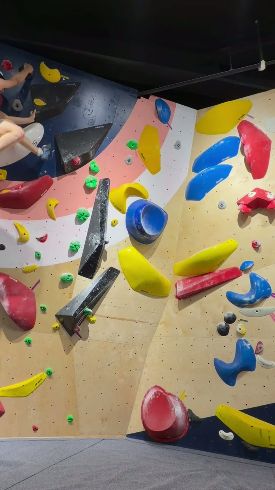
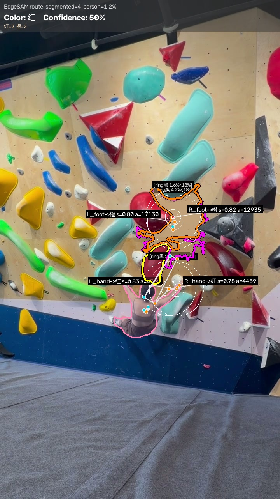
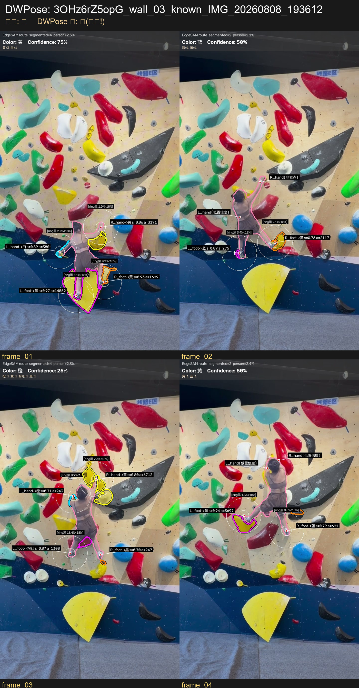

# EdgeSAM for Climbing Route Color Recognition

> 从攀岩视频帧自动识别攀爬者正在攀爬的**线路颜色**（紫/黄/绿/蓝/红/粉/白/黑/青…）。
> 基于 EdgeSAM 语义分割 + MediaPipe Pose 端点定位 + 像素级颜色投票。

[](LICENSE)
[]()
[](https://github.com/chongzhou96/EdgeSAM)

---

## ✨ Highlights

- **Body-Anchored Visual Prompting**: 用 person mask 引导 EdgeSAM 的 box 和负点采样，在"攀岩者嵌入 hold"场景稳定分割
- **Ring-Based Black Vote Correction**: 零额外推理修复端点偏移导致的黑 hold 漏切（环形带黑票阈值 18%）
- **Person-Bbox-Adaptive Box**: box half ≤ person bbox 短边 × 0.6，避免切到远处无关 hold
- **10/10 wall-level accuracy** on 2 sport climbing videos (65 frames, 10 walls)

---

## 📸 Demo

| Hold 颜色识别 (单帧) | 视频帧聚合 |
|---|---|
|  |  |
|  |  |
|  |  |

更多示例见 [`docs/demo/`](docs/demo/)。

---

## 🚀 Quick Start

### 1. 环境

```bash
# 必须 Python 3.12+（EdgeSAM 的 torch/timm wheel 要求）
# 推荐 conda 环境
conda create -n climbing python=3.12 -y
conda activate climbing

# 基础依赖
pip install opencv-python numpy mediapipe==1.0.0

# EdgeSAM 推理依赖（CPU 版）
pip install torch torchvision --index-url https://download.pytorch.org/whl/cpu
pip install timm yacs
```

### 2. 下载权重

```bash
python download_weights.py          # 下载全部
python download_weights.py edgesam yolo26  # 按需下载
```

或手动下载到项目根：
- `edge_sam.pth` (~40MB) — [EdgeSAM 官方](https://github.com/chongzhou96/EdgeSAM)
- `yolo26m-seg.pt` (~53MB) — ultralytics v8.4.0 release
- `pose_landmarker_*.task` (~5-29MB) — [MediaPipe Pose](https://developers.google.com/mediapipe/solutions/vision/pose_landmarker)
- `yolox_l.onnx` (206MB) + `dw-ll_ucoco_384.onnx` (128MB) — [DWPose](https://github.com/TH14GZI-J/DWPose-onnx)（可选，DWPose 实验用）

### 3. Clone EdgeSAM 源码

```bash
git clone --depth 1 https://github.com/chongzhou96/EdgeSAM.git
```

### 4. 运行

```bash
# 单图识别
python test_edge_sam.py --img img/1.jpg

# 视频帧 wall 聚合（路线色识别）
python test_edge_sam.py --aggregate-walls
```

> ⚠️ **MediaPipe 1.0.0 TFLite 析构慢**（约 42s/进程），脚本末尾使用 `os._exit(0)` 跳过 GC 卡顿。`debug/test_no_os_exit_mp.py` 验证了正常 return 也可工作。

---

## 📊 Results

### 单图测试集（15 张，EdgeSAM v2 管线）

| # | 真值 | 判定 | 命中 | 备注 |
|---|---|---|---|---|
| 1 | 紫 | 紫 75% | ✅ | EdgeSAM 切到紫色 hold |
| 2 | 黄 | 黄 67% | ✅ | |
| 3 | 绿 | 绿 100% | ✅ | |
| 4 | 粉红 | 粉红 100% | ✅ | 同色伪装墙（粉墙粉点） |
| 5 | 橙 | 橙 67% | ✅ | |
| 6 | 黄 | 白 100% | ❌ | EdgeSAM 切不到黄 hold（R_foot 判白） |
| 7 | 红 | 红 67% | ✅ | |
| 8 | 蓝 | 紫 100% | ❌ | 蓝 hold 被 person mask 吞（R_foot 切到粉/紫） |
| 9 | 白 | 白 100% | ✅ | 相对白路径触发 |
| 10-15 | — | — | — | 扩展测试集（见 `LESSONS.md`） |

**基线 8/9（6/8 失败为 EdgeSAM 切割固有失败，非后处理可解）**

### 视频全量回归（2 段攀岩视频，65 帧 / 10 walls）

| 视频 wall | 真值 | DWPose + EdgeSAM + Ring 黑修正 + Box 自适应 | 状态 |
|---|---|---|---|
| 2XRo7VbPgTe wall_01 | 黑 | 黑 14/26 | ✅ |
| 2XRo7VbPgTe wall_02 | 蓝 | 蓝 19/30 | ✅ |
| 2XRo7VbPgTe wall_03 | 粉红 | 粉红 10/23 | ✅ |
| 2XRo7VbPgTe wall_04 | 青 | 青 7/21 | ✅ |
| 3OHz6rZ5opG wall_01 | 蓝 | 蓝 10/30 | ✅ |
| 3OHz6rZ5opG wall_02 | 红 | 红 13/28 | ✅ |
| 3OHz6rZ5opG wall_03 | 黄 | 黄 6/12 | ✅ |
| 3OHz6rZ5opG wall_04 line1 | 白 | 白 6/16 | ✅ |
| 3OHz6rZ5opG wall_04 line2 | 粉红 | 粉红 4/15 | ✅ |
| 3OHz6rZ5opG wall_05 | 绿 | 绿 8/24 | ✅ |

**10/10 wall-level 命中**（每帧 ~8.06s on CPU）

---

## 🏗️ 项目结构

```
mediapipe2/
├── test_edge_sam.py            # 主入口：EdgeSAM + MediaPipe 单帧识别
├── edgesam_holds.py            # EdgeSAM segmenter 包装（box prompt、候选筛选、ring 黑修正）
├── route_color.py              # HSV 颜色分类 + 端点邻域像素投票
├── yolo_person_mask.py         # YOLO26m 攀岩者人体分割
├── edgesam_stub.py             # stub mmdet/mmcv 让 EdgeSAM 纯推理能 import
├── download_weights.py         # 权重下载脚本
├── debug/                      # 探索性脚本（按惯例保留）
├── dwpose_exp/                 # DWPose 实验子项目（与 MediaPipe 生产解耦）
│   ├── exp_dwpose_full.py      # DWPose 全量回归
│   ├── dbg_line1_frame02_candidates.py  # 4 候选 mask 选择可视化
│   └── README.md
├── EdgeSAM/                    # EdgeSAM 源码 clone（gitignored）
├── weights/                    # EdgeSAM 权重（gitignored）
├── docs/demo/                  # README 引用的精选 demo 图
├── PIPELINE.md                 # 完整管线技术细节
├── LESSONS.md                  # 12 章工程踩坑与经验
├── PRODUCT.md                  # 9 张图诊断（项目起源）
└── CHANGELOG.md                # 版本变更
```

---

## 🧪 关键设计

### 1. EdgeSAM box+point prompt（核心）
- **box** = 端点周围自适应半边长（按 person bbox 短边 × 0.6 上限）
- **1 正点**（端点位置）+ **14 负点**（1 身体方向 + 5 均匀围绕 + 8 person mask 边缘外）
- `num_multimask=4` 候选 → 选 (-score, +dist, -area) 最优

### 2. Ring-Based Black Vote Correction（零额外推理）
- 动机：MediaPipe 端点偏移时（如 2X_01 R_hand 偏 49px），EdgeSAM 切不到真 hold
- 方案：mask 判色非黑时，统计 mask 外扩 20-70px 环带黑票占比 ≥ 18% → 修正为黑
- 方向不对称：彩色 hold 环带占多无信息量；黑 hold 在彩色墙稀缺 = 信号
- **修复 2X_01 黑线 miss**（line1_white 从橙 → 白 ✅）

### 3. Pixel-Level Color Voting
- 替代 `_sample_color` 均值采样
- 每个像素按规则分桶（黑/白/红/橙/黄…），桶计数投票
- 不再系统剔除低饱和像素，多色混合 mask 也稳定

### 4. Person-Bbox-Adaptive Box
- `compute_box_half(h, person_mask)` 函数
- box half = max(BOX_HALF_MIN, h // BOX_HALF_HEIGHT_DIV)，上限 person bbox 短边 × 0.6
- **修复 line1_white R_hand 选远处红色 hold**（box=160 → 128 后手边白 hold 胜出）

详见 [`PIPELINE.md`](PIPELINE.md) 技术细节。

---

## 📚 文档

- **[PIPELINE.md](PIPELINE.md)** — 完整技术细节（box/point prompt 设计、ring 黑修正算法、像素级投票、跨帧聚合）
- **[LESSONS.md](LESSONS.md)** — 12 章工程经验（EdgeSAM 集成踩坑、MediaPipe flip ensemble、HSV 圆形均值、YOLO26 vs DWPose 端点对比）
- **[PRODUCT.md](PRODUCT.md)** — 9 张图诊断记录（项目起源：第一版"颜色空间分割"的极限场景分析）
- **[dwpose_exp/README.md](dwpose_exp/README.md)** — DWPose 实验子项目说明

---

## 🔬 引用

如果你在论文中使用了本项目：

```bibtex
@misc{climbing_edge_sam_2026,
  title={EdgeSAM-based Climbing Route Color Recognition},
  author={Curren},
  year={2026},
  url={https://github.com/curren/mediapipe2}
}
```

依赖项目：

- [EdgeSAM](https://github.com/chongzhou96/EdgeSAM) — Zhou et al., "EdgeSAM: Prompt-In-the-Loop Distillation for On-Device Deployment of SAM"
- [MediaPipe](https://developers.google.com/mediapipe) — Google, "MediaPipe Pose"
- [YOLO26](https://github.com/ultralytics/ultralytics) — Ultralytics
- [DWPose](https://github.com/TH14GZI-J/DWPose-onnx) — DWPose: Efficient Whole-body Pose Estimation

---

## 📝 已知限制

1. **白色 hold 端点偏移问题**：line1_white wall 整体判白 ✅（聚合救回），但逐帧看仅 2/5 帧端点在白 hold 上，其他帧攀岩者抓黄/青 hold
2. **EdgeSAM 小目标切割**：6/8/15.jpg 等场景 EdgeSAM 切不到目标 hold（远景、密集 hold）
3. **MediaPipe 端点精度**：手/脚遮挡时 conf 掉到 0.1-0.26，替代方案 DWPose 已在 `dwpose_exp/` 验证
4. **CPU 推理慢**：每帧 ~8.06s（EdgeSAM + 2 ONNX + YOLO26m + MediaPipe），GPU 加速可降至 <1s

---

## 🤝 贡献

欢迎 issue 和 PR！

- 修复 bug / 添加功能请先开 issue 讨论
- 提交代码请确保 `python -m py_compile` 通过
- 新的调试脚本请放 `debug/` 子目录

---

## 📄 License

MIT — 见 [LICENSE](LICENSE)。
