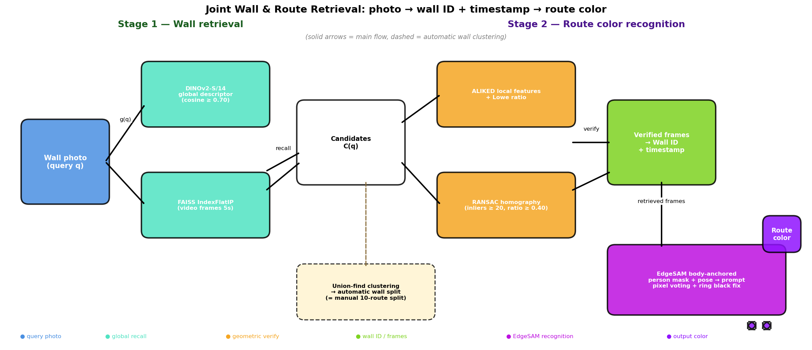
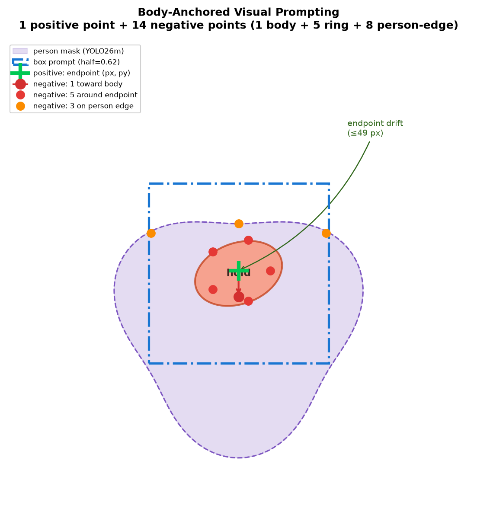
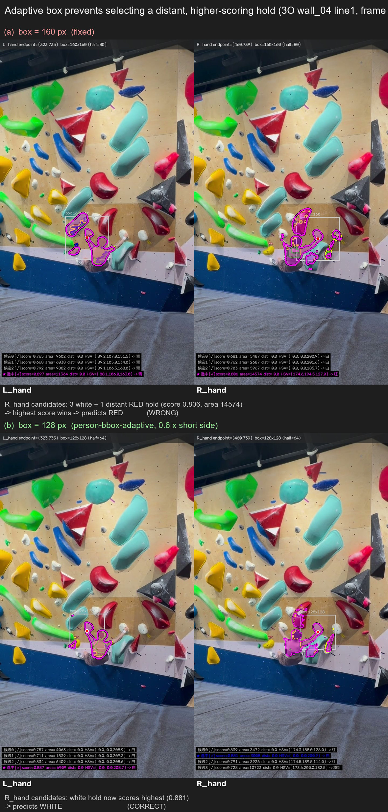
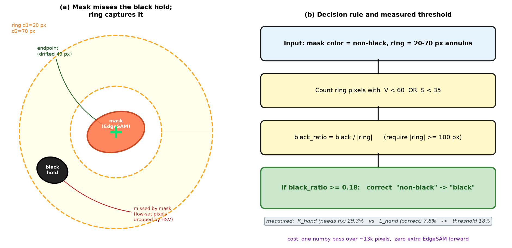
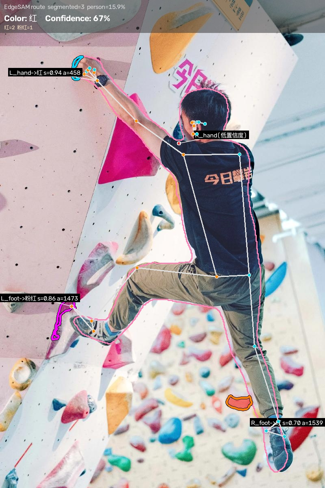
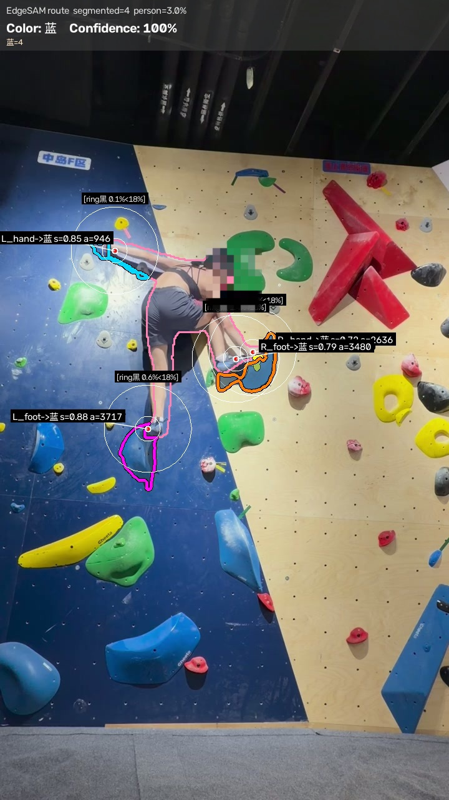
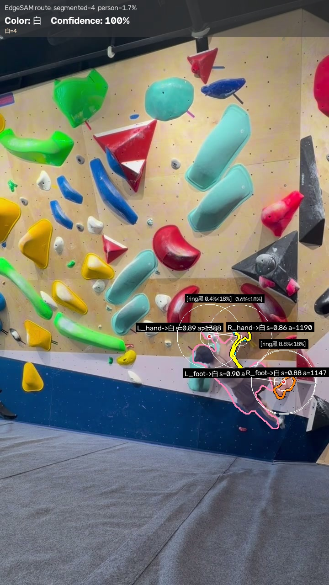
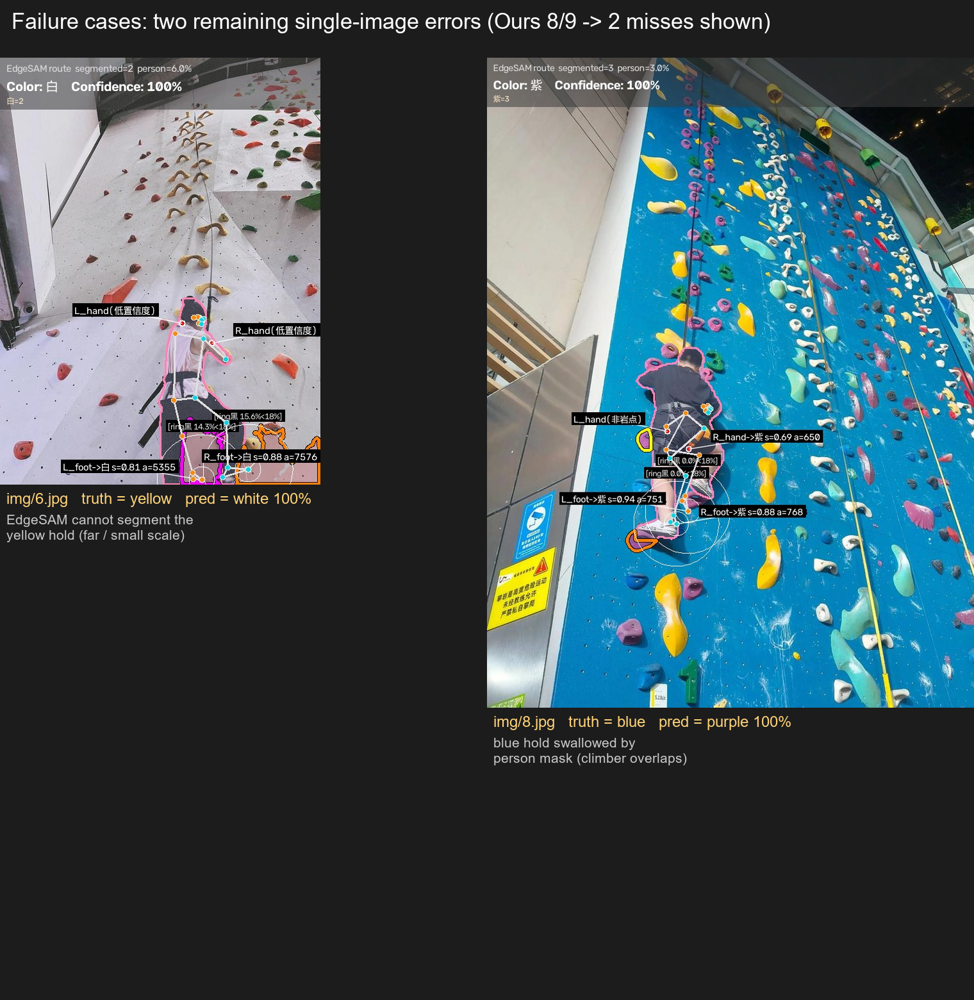

# 从一张照片到「你正在爬哪条线」

> 攀岩视频路线颜色识别 + 墙面联合检索的完整实践

在岩馆里，一面墙上可能挂着几十条路线，颜色是唯一能区分它们的标识——白线、粉线、黑线、青线……当你想把刚爬完的视频发到群里说"这条线是啥颜色"，或者帮教练整理一条线路的照片时，一个很朴素的问题就出现了：**这条路线到底是什么颜色？**

听起来像是个玩具问题，但真做起来会发现相当棘手。这篇文章记录了我在这个项目上踩过的坑和最终跑通的一套方案：

- **Stage 1 墙面检索**：给一张墙的照片，自动找出它是哪面墙、对应视频的哪一段
- **Stage 2 路线颜色识别**：从攀岩视频帧里，识别出攀爬者正在爬的那条线是什么颜色

最终在 10 面墙（覆盖 9 种颜色）上做到 **10/10 墙段级命中**，同批墙面上的纯颜色空间基线只有 4/10 和 6/10；检索阶段在 34 张照片上留一法评测 **100% / 100% 精确率 / 召回率**，照片→视频→颜色的端到端链路 **7/7 命中**。

代码、论文（中英双语）、实验脚本全部开源：<https://github.com/CurrenWong/climb-color>



---

## 一、任务是什么，有多难

输入是攀岩视频的抽帧，输出是「这一帧的攀爬者正在爬的路线颜色」——需要区分紫、黄、绿、蓝、红、粉、白、黑、青 9 种颜色。

看起来只是"取个颜色"，但实际有三个硬骨头：

**1. 人体和岩点长在一起。** 攀岩者抓握时，手掌几乎包住整个岩点，边缘的掩码会把皮肤和岩点混在一起。直接用通用分割模型切，岩点大概率被吞掉或切破。

**2. 同色墙。** 粉墙上的粉色岩点、蓝色墙面上的蓝色岩点，颜色分割在这里几乎失效——人和点之间的边界还在，但"点是什么颜色"这个信号本身没了。

**3. 动态 + 光照。** 攀岩者的身体持续移动，视角在变，手部像素在暗部和灯光之间反复横跳。

我的判断是：难点不在"取颜色"，而在**"先精准切出目标岩点，再取颜色"**。所以整个方案的重心都压在分割环节。

---

## 二、整体架构：两阶段

```
照片 ──► Stage 1 墙面检索 ──► 墙段 ID + 时间戳
                                  │
视频帧 ───────────────────────────►│
                                  ▼
                    Stage 2 路线颜色识别
                    （身体锚定视觉提示 → 候选筛选
                      → 像素级颜色投票 → 环形带黑票修正
                      → 跨帧聚合）
```

Stage 2 也就是论文里的识别流水线，有四个关键组件，下面逐个拆。Stage 1 的检索部分放在后面单独讲。

---

## 三、Stage 2：四个关键设计

### 3.1 身体锚定视觉提示（Body-Anchored Visual Prompting）

EdgeSAM 这类可提示分割模型接受 box + point 提示。直接把人体掩码从图里减掉，剩下的"东西"大部分就是岩点，但有几个坑：

- 减得太狠，岩点被削掉一圈，颜色统计失真
- 减得太松，手臂边缘的阴影会被当成岩点
- 远处无关的岩点也会混进来

最终的做法是**用人体掩码去引导提示的布局**，而不是简单做减法：

- **box**：端点周围的自适应框（半径上限 = 人体外接框短边 × 0.6）
- **1 个正点**：手腕关键点（抓握点）
- **14 个负点**：1 个朝身体方向的点 + 5 个均匀环绕 + 8 个落在人体掩码边界上

正点告诉你"我要哪个"，负点告诉模型"哪些不要"。这 14 个负点比正点数量更多——因为这个场景里，**排除人体和近邻岩点比定位目标更难**。

每个提示会生成 4 个候选掩码，按 `(-score, +到端点距离, -面积)` 排序取最优：分数高的优先，同分时优先离端点近的（更可能是真抓握点），再同分时优先面积小的（避免切到"碰巧很大"的墙面区域）。



### 3.2 人体框自适应采样框（Person-Bbox-Adaptive Box）

采样框固定 160 像素的时候，会框进远处一个无关的红点，把它的颜色当成答案。

所以采样框半径不设固定值，而是**跟着人体外接框的短边走**：`min(160, 人体短边 × 0.6)`，同时有 50 像素的下限防止人体框太小时塌缩。

这一条改动在消融里单独贡献了 +1 面墙的准确率（9/10 → 10/10），而且几乎不增加计算量。



### 3.3 像素级颜色投票（Pixel-Level Color Voting）

最朴素的取色方式是：在端点附近采样，算平均 HSV。

问题是**平均会被少数异常像素拖死**。一个端点周围 100 个像素里如果有 3 个被阴影染成深色，平均色相就废了；而且低饱和度的像素（灰、脏白）往往被直接丢弃，等于系统性丢信息。

改成**逐像素分桶 + 计数投票**：

- 每个像素按规则落桶（黑 / 白 / 红 / 橙 / 黄 / 绿 / 青 / 蓝 / 紫 / 粉红）
- 统计各桶计数，取票数最高的桶
- 低饱和度像素不再被剔除，而是按单独规则处理

另外还有一条"**相对白**"路径：白岩点在暖光或阴影下饱和度会掉，直接按 HSV 判会变灰。做法是算环境环的平均饱和度作为基线，岩点像素的饱和度明显低于环境时判为白。这条路径不是某个图的特例，是通用机制。

### 3.4 环形带黑票修正（Ring-Based Black Vote Correction）

这是整套方法里我最满意的一个设计，因为它**零额外推理成本**。

背景：端点定位有误差——手腕关键点并不等于抓握点。手指环抱岩点时，岩点中心可能距手腕 30–50 像素，甚至超过岩点自身半径。实测误差最大到 49 像素。

后果是：EdgeSAM 根本没把那个深色岩点切进掩码，掩码里取到的是墙面 → 判定为"不是黑"。而黑色岩点恰恰是最难判的——黑hold 在深色墙面上几乎不可分。

修正方案：**当掩码判色不是黑色时，统计掩码外侧 20–70 像素环带里的黑色票占比，占比 ≥ 18% 就改判为黑。**

这个设计依赖一个领域特性——**信息不对称**：

- 彩色岩点出现在环带里是常态（无信息量）
- 深色岩点出现在彩色墙面的环带里是稀缺事件（是信号）

所以"环带里有黑票"这件事本身就携带信息，不需要再跑一遍分割。

实测：掩码外 20–70px 环带黑票占比 ≥ 18% 时改判黑色，零额外推理开销，修好了因端点偏移漏切的深色岩点。



---

## 四、Stage 1：墙面检索（照片 → 墙 → 颜色）

识别管线再准，也得先知道看的是哪面墙。所以我把一个已有的岩壁检索器合并进来，做成**照片 → 墙 → 颜色**的联合系统。

两阶段分工明确：

- **Stage 1（检索）**：DINOv2-S/14 做全局特征召回 → ALIKED 局部特征 + Lowe ratio + RANSAC 单应性做几何验证 → 并查集聚类自动切分墙段
- **Stage 2（识别）**：在检索选出的帧上跑上面那套识别流水线

检索的一个附带好处是**墙段边界不再需要手工给**：对视频帧做聚类，自动切分的结果和人工切分完全一致（9 个物理墙段），"墙边界作为输入"这个假设被端到端移除了。

### 检索结果

| 评测 | 指标 | 结果 |
|---|---|---|
| 34 张照片留一法（混合索引：其余 33 照片 + 65 视频帧） | 精确率 / 召回率 | **100% / 100%** |
| 7 张照片 → 视频墙段链路 | any-hit / top-1 | **7/7** / 6/7 |
| 自动墙聚类 vs 人工切分 | 墙段数 | 9 = 9（完全一致） |
| 端到端（照片 → 墙 → 颜色） | 联合准确率 | **7/7** |

> **一个有意思的细节**：34 张照片的标注是"路线时段"粒度，而不是"物理墙"粒度。比如 `IMG_193753` 和 `IMG_193754` 是相隔 1 秒的连拍，拍的是同一面墙（中间区域重叠、左右取景不同），但因为对应墙上两条不同颜色的路线，被标成了 `2X_wall_01` 和 `2X_wall_03`。所以论文里明确写了检索按**物理墙**判定，而不是按路线标签——否则唯一那个"top-1 失误"会被误读成检索错误，其实只是标签粒度不同。

---

## 五、实验结果

### 单图测试集（15 张）

| 场景 | 真值 | 判定 | 命中 |
|---|---|---|---|
| 紫色岩点 | 紫 | 紫 75% | ✅ |
| 黄色岩点 | 黄 | 黄 67% | ✅ |
| 绿色岩点 | 绿 | 绿 100% | ✅ |
| 同色墙（粉墙粉点） | 粉红 | 粉红 100% | ✅ |
| 橙色岩点 | 橙 | 橙 67% | ✅ |
| 远景小黄点 | 黄 | 白 100% | ❌ |
| 红色岩点 | 红 | 红 67% | ✅ |
| 被身体遮挡的蓝点 | 蓝 | 紫 100% | ❌ |
| 白色岩点 | 白 | 白 100% | ✅ |

8/9 命中，两个失败案例的机理见下节。

### 识别效果示例

青色/橙色轮廓 = 切出的岩点掩码，白圈 = 环形带，粉线 = 人体掩码。







### 视频全量回归（2 段视频 / 65 帧 / 10 墙段）

| 墙段 | 真值 | 判定（票数） |
|---|---|---|
| 2X wall_01 | 黑 | 黑 14/26 ✅ |
| 2X wall_02 | 蓝 | 蓝 19/30 ✅ |
| 2X wall_03 | 粉红 | 粉红 10/23 ✅ |
| 2X wall_04 | 青 | 青 7/21 ✅ |
| 3O wall_01 | 蓝 | 蓝 10/30 ✅ |
| 3O wall_02 | 红 | 红 13/28 ✅ |
| 3O wall_03 | 黄 | 黄 6/12 ✅ |
| 3O wall_04 line1 | 白 | 白 6/16 ✅ |
| 3O wall_04 line2 | 粉红 | 粉红 4/15 ✅ |
| 3O wall_05 | 绿 | 绿 8/24 ✅ |

**10/10 墙段命中**，CPU 上 7.2 秒/帧。

### 与基线对比（同 10 面墙）

| 方法 | 墙段级准确率 |
|---|---|
| 端点环向采样（纯颜色空间） | 4/10 |
| HSV 连通域 | 6/10 |
| 通用视觉大模型（Qwen-VL） | 5/10 |
| **本方法** | **10/10** |

组件递进：4 → 6 → 8 → 9 → 10（每加一个组件涨一面墙）。

另外做了个统计严谨性检查：帧级 bootstrap 期望是 8.2/10，"跑出饱和结果（10/10）的单次概率"是 12%。也就是说 10/10 不是运气——但也确实是小样本，**34 张照片、10 面墙不足以支撑泛化性声明**，这点我在论文里写得很克制。

---

## 六、失败案例与已知边界

这部分我觉得比结果更重要。



**1. 端点定位是主要误差源。** 手腕关键点 ≠ 抓握点。手指环抱岩点时，岩点中心可能距手腕 30–50 像素，超过岩点自身半径。后处理（环形带修正）只能缓解，治不了根。

**2. 小目标与密集岩点是分割的硬边界。** 远景小黄点那个失败案例就是：目标太小，EdgeSAM 的编码器特征直接衰减，切到了墙面。这类问题不是调参能解决的。

**3. 身体遮挡造成的信息损失是不可恢复的。** 攀岩者身体压住岩点时，减去人体掩码后可能只剩几十个像素，颜色统计随之失真——单帧里信息确实不存在了，任何算法都救不回来。

**4. 统计口径要看清。** 墙段级结论依赖多帧聚合，5 秒采样间隔下每面墙只有 4–9 帧，少数噪声票就能左右结果。把最弱的三面墙按 1 秒重采后，平均票差从 +1.7 提升到 +14.3 票——说明脆弱主要来自采样密度，但也有两面墙几乎不动，那是系统性偏差。

**5. CPU 慢。** 每帧约 7.2 秒（EdgeSAM 编码 + 4 个端点查询 + 两个 ONNX 模型 + YOLO26m），GPU 估计可降到 1 秒内。所有数字都是 CPU 实测。

**6. 检索的门限是手调的。** 召回门限（余弦 ≥ 0.70）和 RANSAC 门限是在这个岩馆的墙面纹理上标的，换岩馆或换光照需要重调。

---

## 七、开源

- **代码**：<https://github.com/CurrenWong/climb-color> （MIT）
- **论文**（中英双语 Markdown + DOCX）：`paper/` 目录
- **管线技术细节**：`PIPELINE.md`
- **工程踩坑记录**：`LESSONS.md`

依赖的模型：EdgeSAM（提示分割）、YOLO26m（人体掩码）、MediaPipe Pose / DWPose（手腕关键点）、DINOv2-S/14 + ALIKED（检索）。

想自己跑：

```bash
python download_weights.py          # 下载权重
python test_edge_sam.py --img img   # 单图识别
python test_edge_sam.py --aggregate-walls   # 视频墙段聚合
```

---

## 八、接下来想做什么

现在的系统回答的是"这条线是什么颜色"。顺着这个方向往下走，能做的事其实不少：

- **路线级识别**：从"颜色"升级到"这是哪条路线"（需要路线级别的标注）
- **时序模型**：现在用的是墙段级多数票投票，简单但有效；换成轨迹平滑或 LSTM 会更强，代价是需要额外的监督
- **多攀岩者场景**：现在假定墙上只有一位攀岩者
- **教练辅助工具**：把识别结果和岩馆的路线库对接，做成"你爬的这条线叫 XX"

如果你也做攀岩相关的项目，或者对"提示分割 + 姿态先验"这套组合感兴趣，欢迎来开 issue 聊。

---

*项目作者：Curren · 图片素材来自公开网络平台（部分已打码），仅用于研究与演示。*
